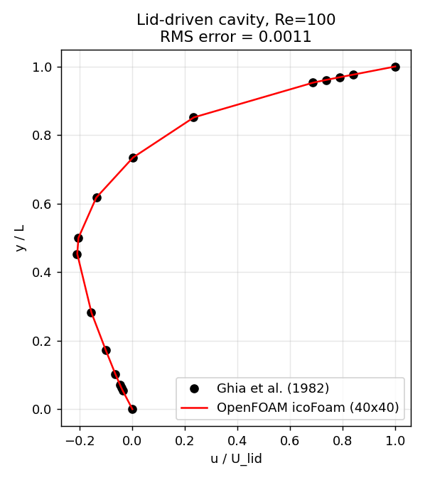

   
   # CFD-Agent - LLM agent for automated OpenFOAM lid-driven cavity CFD

Type a request in plain English; the agent sets up, meshes, solves and **validates** an OpenFOAM
lid-driven cavity case and writes a report:

```
cfd-agent run "simulate cavity flow at Re 400 on a 48x48 grid"
```

## Design principle: the LLM never writes solver files

```mermaid
flowchart LR
  A[User request] --> B{Parameter extraction}
  B -->|1st| L[LLM tool call -> JSON]
  L -->|Pydantic validation| V[CavitySpec]
  L -->|invalid: 1 re-prompt, then| R[Rule-based parser]
  R --> V
  V -->|out of range / unsupported| X[Rejected - nothing is run]
  V --> C[Jinja2 templates -> case files]
  C --> M[blockMesh] --> G1{checkMesh gate}
  G1 --> S[icoFoam] --> G2{convergence gate}
  G2 --> P[Post-process + Ghia benchmark] --> G3{RMS gate}
  G3 --> O[report.md + plot + audit.jsonl]
  G1 -.fail.-> T[Retry ladder, max 3]
  G2 -.fail.-> T
  G3 -.fail.-> T
  T -.refine mesh x1.5, then halve Courant.-> C
```

* The LLM (optional) does one thing: turn text into `{reynolds, grid_n, lid_velocity}` via a forced tool call.
  Output is validated by Pydantic; invalid -> one re-prompt -> deterministic rule-based fallback.
* Values the user states that are out of range are **rejected, never silently clamped**.
  Values the user omits get documented defaults and a warning in the report.
* The pipeline order is enforced in code (`agent.py`); no step can be skipped.
* Retry ladder (bounded, max 3 attempts): as requested -> refine mesh x1.5 -> refine again + halve Courant target.
  Tool-missing (rc 127) and solver-timeout abort early because refinement cannot help.
* Every tool call is logged to `audit.jsonl`.

## Quality gates (all in `checks.py` / `postprocess.py`)

| Gate | Pass condition |
|---|---|
| Mesh | `checkMesh` says "Mesh OK"; non-orthogonality <= 65, skewness <= 4, aspect ratio <= 50 |
| Solver | clean exit, no fatal error/NaN, final Ux/Uy initial residual <= 1e-6, max Courant <= 1 |
| Benchmark (Re = 100 or 400) | u-velocity centerline RMS error vs Ghia et al. (1982) <= 0.05 |

For other Reynolds numbers there is no reference table, so benchmark validation is **skipped and reported as skipped**
(never silently passed).

## Results (real OpenFOAM v1912, Ubuntu apt package)

`cfd-agent eval` runs the 20 requests in `benchmarks/requests.json`:

| Metric | Result |
|---|---|
| Valid requests completed correctly | 16 / 16 |
| Invalid requests safely rejected (no simulation run) | 4 / 4 |
| Cases validated against Ghia | 9 (mean RMS 0.0043, max 0.0118) |
| Mean runtime per valid request | 12.5 s |

Full table: `samples/eval_results.md`. Example report with plot: `samples/re100_40x40/`.
Retry ladder on a real solver: `samples/retry_demo_re400_12x12/` (12x12 failed the benchmark gate with RMS 0.0596,
was refined to 18x18 and passed).

**What "100%" means:** every case in this 20-request suite passed. It is not a guarantee for arbitrary inputs.

## Setup

OpenFOAM is Linux software. On Windows use **WSL2 (Ubuntu)**.

```bash
sudo apt install openfoam            # Ubuntu/Debian package (OpenFOAM v1912); ESI packages also work
python -m venv .venv && source .venv/bin/activate
pip install -e ".[dev,llm]"
cfd-agent check-env                  # confirms OpenFOAM is found
pytest                               # 42 tests; the 2 real-solver tests skip automatically if OpenFOAM is absent
cfd-agent run "lid-driven cavity at Re 100 with a 40x40 grid"
cfd-agent eval                       # the 20-request evaluation
```

If OpenFOAM's `bashrc` is somewhere unusual: `export CFD_AGENT_FOAM_BASHRC=/path/to/etc/bashrc`.

Optional LLM extraction: `export ANTHROPIC_API_KEY=...` (from the environment only, never commit it), then
`cfd-agent run "..." --llm anthropic`. Without it the rule-based parser is used.

`--runner mock` runs the whole pipeline against a synthetic solver for dry runs/CI. Mock output is labelled
**MOCK RUN** in every report and is never benchmark-validated.

## Project layout

```
cfd_agent/  schemas.py  case_builder.py  templates/  runners/{base,openfoam,mock}.py
            checks.py   postprocess.py   benchmarks.py  rules.py  llm_client.py
            agent.py    report.py        audit.py  evaluation.py  cli.py
tests/      benchmarks/requests.json     samples/
```

## Known limitations (read before quoting results)

* Scope: 2D, laminar, incompressible, uniform-grid lid-driven cavity (icoFoam), Re 10-1000. Nothing else.
* Ghia reference values were transcribed by hand; they reproduce well (RMS ~0.001 at Re = 100), but verify them
  against the paper before publishing numbers.
* The benchmark gate (0.05) is lenient on purpose so coarse grids can pass; tighten it for publication-quality work.
* The Anthropic LLM client is written against the public SDK and tested with scripted mocks only; it was **not run
  against the live API** in the build environment. The rule-based path is what the 20-case evaluation used.
* Docker mode (`OpenFOAMRunner(mode="docker")`) is implemented but **untested**.
* Tested on OpenFOAM v1912 (Ubuntu package). Newer versions should work with these simple dictionaries but are unverified.
* Validation covers the u-velocity centerline only.
