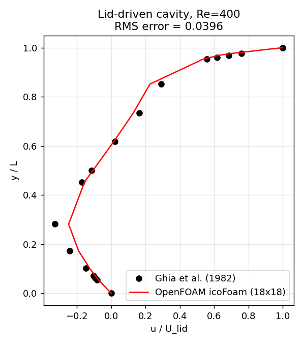

# CFD-Agent report

**Request:** lid-driven cavity at Re 400 with a coarse 12x12 grid

**Status:** `SUCCESS` - Completed after 2 attempt(s).

**Parameter source:** rules  |  **Runner:** openfoam-native  |  **OpenFOAM:** 1912 patch 200626

## Warnings
- Required mesh refinement; final grid differs from the requested grid

## Final case parameters

| Parameter | Value |
|---|---|
| Reynolds number | 400 |
| Grid | 18 x 18 (1 cell deep, 2D) |
| Lid velocity | 1 m/s |
| Cavity size | 0.1 m |
| Kinematic viscosity nu | 0.00025 m^2/s |
| Time step | 0.001111 s (target Courant 0.2) |
| End time | 8.00031 s (7201 steps) |

## Attempts

| # | Grid | Mesh gate | Solver gate | Max Co | Final Ux res | Benchmark RMS | Result |
|---|---|---|---|---|---|---|---|
| 1 | 12x12 | pass | pass | 0.11 | 3.0e-10 | 0.0596 | FAILED: benchmark validation failed: RMS error 0.0596 > 0.05 |
| 2 | 18x18 | pass | pass | 0.14 | 2.2e-10 | 0.0396 | OK |

## Mesh quality (final attempt)

| Metric | Value | Limit |
|---|---|---|
| Cells | 324 | |
| Max non-orthogonality | 0 deg | 65 |
| Max skewness | 1.5e-14 | 4 |
| Max aspect ratio | 1 | 50 |

## Convergence (final attempt)

- Final initial residuals: Ux 2.17e-10, Uy 2.57e-10, p 2.21e-09 (gate: Ux,Uy <= 1e-6)
- Relative change in U between last two write times: 1.19e-07

## Benchmark validation

- Reference: Ghia et al. (1982) u-centerline
- u-centerline RMS error: **0.0396** (max 0.0792) over 15 points; gate <= 0.05
- Result: PASS

---
Parameters were validated by code; case files come from templates; every tool call is in `audit.jsonl`.
